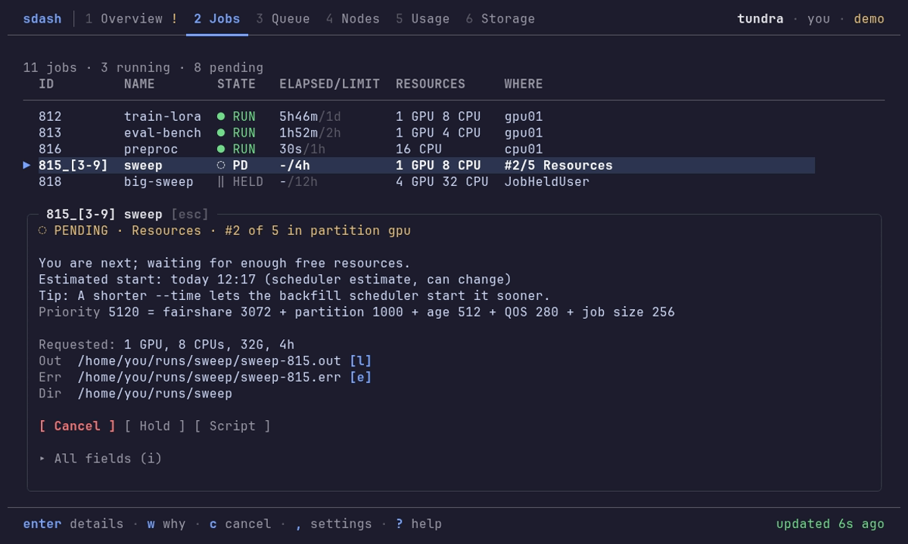
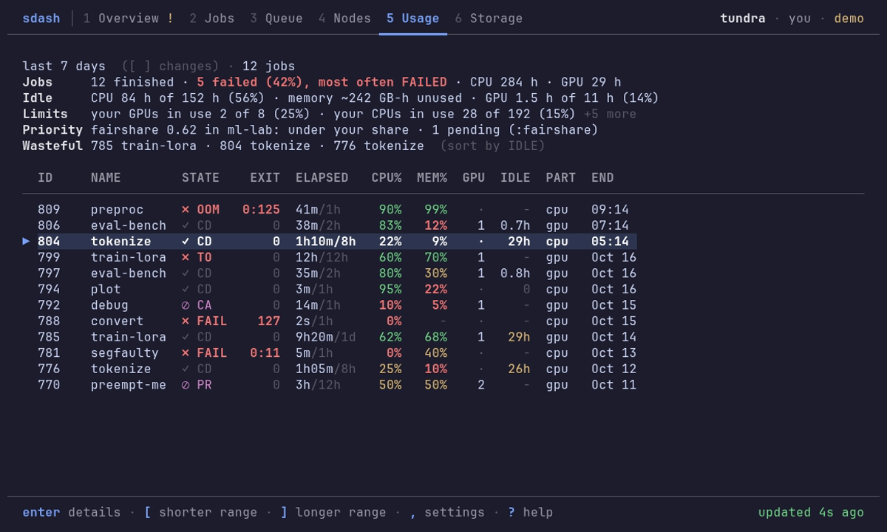
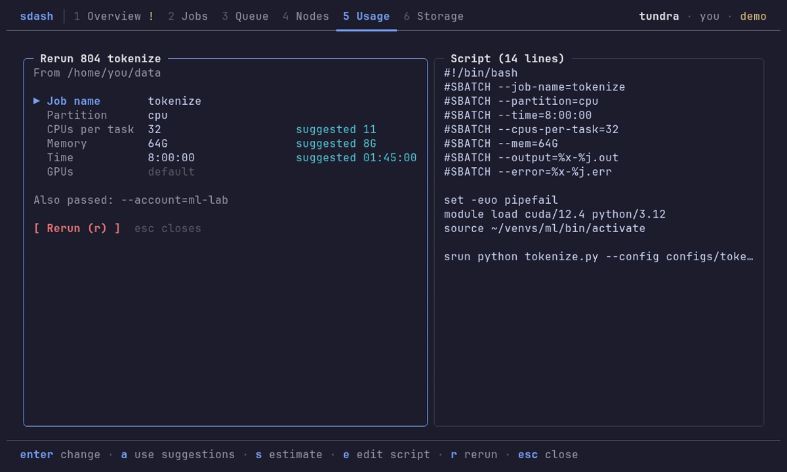
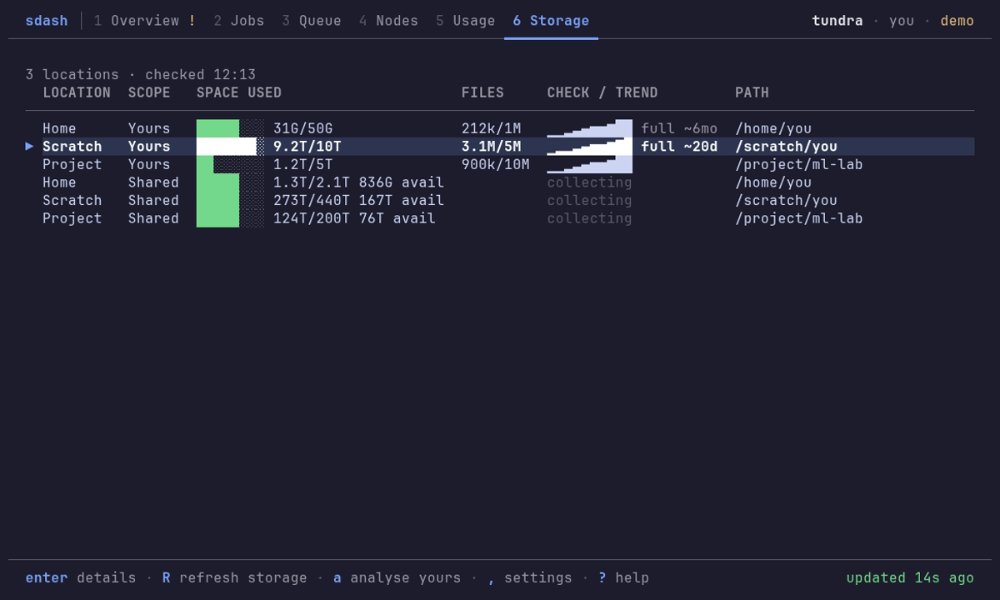

# sdash: Slurm Dashboard

A terminal dashboard for Slurm jobs, queues, CPU and GPU capacity, usage and
storage. It explains why jobs are pending, shows unused resources and finds
where new jobs fit. Runs on Linux login nodes with your own permissions and the
Slurm commands on your `PATH`. No root access, daemon or database required.


## Install and run

```sh
curl -fsSL https://raw.githubusercontent.com/nbharathik/slurm-dashboard/main/install.sh | sh
```

```sh
sdash          # open the dashboard
sdash --demo   # try it on a simulated cluster
```

Installs one executable (under 20 MiB) in `~/.local/bin`, without root, Go or a
source checkout. Install once on a login node; compute nodes need nothing.
Downloads are checked against SHA-256. See [installation](docs/install.md) for
PATH, offline setup and `sdash update`.

Press `?` for help, `,` for settings and `q` to quit.

## Features

- **Pending jobs:** the reason in plain words, queue position, priority factors
  and a start estimate from the scheduler.
- **Waste:** CPU, memory and GPU time your jobs held but did not use, and a
  rerun with right-sized resources.
- **Free capacity:** CPUs, memory and GPUs per partition and node.
- **Attention:** failed and out-of-memory jobs, jobs near their time limit and
  nearly full quotas.
- **Storage:** quotas with a 30-day trend and a forecast of when they fill up.
- **Scripting:** every view is also a command with `--json` output.

<p>
  
  
  
  
</p>

## Compatibility

Supports Slurm 21.08 to 26.05, tested in CI on every change. sdash reads the
plain text output of the standard client commands, so it needs no slurmrestd,
JSON output or ssh to compute nodes. Missing features such as accounting or
GPUs show a short reason, and `sdash doctor` lists what your cluster offers.
See [compatibility](docs/compatibility.md).

## Security

Runs with your permissions and only acts on your own jobs. Slurm commands use
an allowlist with timeouts; cancel, requeue and rerun show the exact command
and ask first. Slurm text is sanitized before display. No telemetry; updates
contact GitHub, and configured hooks may use the network. Releases are signed
with cosign and ship with SBOMs and build provenance. See [security](SECURITY.md).

## Contributing

Bug reports and reports from clusters sdash has not seen yet help the most. See
[contributing](CONTRIBUTING.md).

[Usage](docs/usage.md) · [Settings](docs/config.md) · [Changelog](CHANGELOG.md) · [MIT licence](LICENSE)
